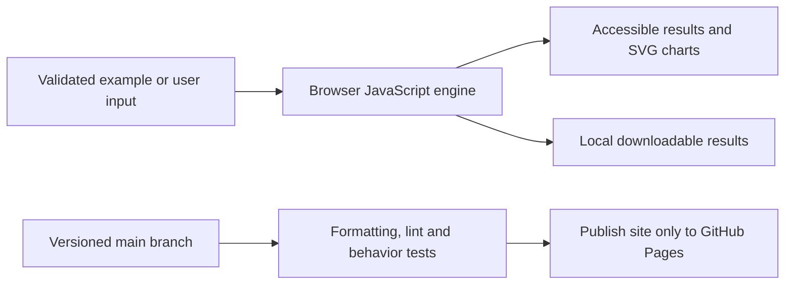

# Image Discovery Workbench

**Reproducible versions:** [Dependency versions and exact setup](DEPENDENCIES.md).


[Open the application](https://subhashdixit.github.io/image-discovery-workbench/) · [Report an issue](https://github.com/subhashdixit/image-discovery-workbench/issues)

Replace a brittle Selenium image-search scrape with an inspectable public-API image discovery workflow that keeps provenance attached.

## What the finished application does

- Search up to 12 bitmap candidates from Wikimedia Commons.
- Inspect image thumbnails, authors, credit and license metadata.
- Open each authoritative file page and export result metadata.

## Use the application step by step

1. Open the live application. Read the input labels and scope panel.
2. Start with the included example to understand the output.
3. Replace it with your own supported input. Files are processed locally unless you explicitly choose a server feature and consent to it.
4. Run the analysis and inspect the visual output together with its limitations.
5. Export your results when the tool offers a download. Keep your own copy; a browser tab is not a durable data store.

## Concepts, algorithms and interpretation

### Discovery is separate from reuse

The MediaWiki query API searches file namespace 6 and requests imageinfo URLs, thumbnails and extended metadata. The browser validates image hosts and renders metadata as text, never as provider HTML. Images load from upload.wikimedia.org; search/source links stay on Commons. This avoids browser-driver installation and fragile selectors.

API metadata can be missing or inconsistent. Attribution, derivative-work restrictions and license versions must be checked on the file page. Commons content is independently licensed per file; an API response does not grant a universal license. Search ranking measures relevance, not license suitability.

## Architecture and data flow



HTML provides the accessible page structure, CSS handles responsive layout, and ES modules separate calculation from user interaction. Pure calculation functions can run in Node tests without a browser. SVG charts scale with the screen; they use explicit axes, labels and legends. CSV exports escape spreadsheet formula prefixes in text cells.


## Run locally from scratch

Install Node.js 22 and Python 3 for a local static HTTP server. Python is not a production backend for this app.

```bash
git clone https://github.com/subhashdixit/image-discovery-workbench.git
cd image-discovery-workbench
npm ci
npm test
npm run lint
npm run format
npm run check
python3 -m http.server 8000 --directory site
```

Open http://localhost:8000. Use HTTP rather than double-clicking HTML so that module imports and local data fetches work consistently. No production API secret belongs in `site/`.

## Coding structure

```text
site/
  index.html       # accessible application interface
  styles.css       # responsive design
  app.js           # interface orchestration
  engine.js        # validated calculations; no DOM dependency
  ui.js            # chart, CSV and download helpers
tests/             # behavior and boundary cases
.github/workflows/pages.yml
archive/           # original README and retired workflows where present
```

Original source files, notebooks and historical artifacts remain in the repository for comparison. The release publishes only `site/`; old source directories and datasets are not automatically exposed by the application.

## CI/CD and deployment

CI means continuous integration: each pull request and main-branch push installs exact lockfile dependencies, checks formatting, lints JavaScript, runs meaningful behavior tests and checks module syntax. A failed check stops publishing. CD means continuous deployment: after the required `Build and test` check succeeds on `main`, GitHub Actions uploads `site/` and GitHub Pages serves it over HTTPS.

The workflow uses pinned action revisions, minimal permissions and a protected main branch. Publishing jobs need Pages/OIDC permissions; test jobs only read source. Feature branches are deleted after merge. Static Pages hosting needs no always-running Python process, but cannot hide secrets, host a Flask process or provide durable server storage.

To set up a fork, enable GitHub Pages with **GitHub Actions** as its source and allow the repository's workflow to run. Repository Settings → Pages shows the deployment URL. If renaming the repository, update the README URL and any absolute links; application resources use relative paths. Check Actions logs if publishing fails.

### Release, monitoring and rollback

A commit identifies exactly which source was deployed. Inspect the Actions deployment and test results before sharing the link. After publishing, open the page, run its example and check exports; a successful HTTP response alone is not a functional test. For rollback, revert the faulty merge in a new PR, pass checks, and merge the revert. This triggers the same reproducible publishing process. Avoid force-pushing protected main or deleting history. Browser caches can retain an older asset briefly; refresh after a deployment.

### Docker and alternatives

Docker packages code and dependencies into a reproducible runtime. This static app does not require a container: Pages serves the same versioned files directly, with less operating work and no container cold starts. A container becomes useful if adding a Python backend; then secrets, patches, resource costs and persistent storage require separate management.

## Data provenance and attribution

Original Image_Scrapper source preserved. Maintained integration uses the official [MediaWiki imageinfo API](https://www.mediawiki.org/wiki/API:Imageinfo) and Commons file metadata. Credits are shown with each result; exported metadata retains source URLs.

## Practical limits

Requires public Commons API/network access; no offline default gallery or fabricated search result. Up to 120 search characters and 12 results. Upstream quotas/CORS/network changes can interrupt search. Image requests expose routine connection metadata to Wikimedia. Original scraping binaries are retained outside site and are not executed.

The test suite checks calculation contracts and invalid inputs. It cannot establish that an input dataset is representative, that a heuristic is scientifically correct for every domain, or that a result is suitable for an automated consequential decision. Read the original source alongside the maintained browser implementation when comparing behavior.

## Local dependency installation

The maintained app is HTML/CSS/JavaScript and needs no Python packages. `requirements.txt` documents this; install development tools with `npm ci` using the pinned Node/npm versions. See [DEPENDENCIES.md](DEPENDENCIES.md). Original prototype requirements are preserved at `archive/prototype-requirements.in` where present; they are not the supported install command.
